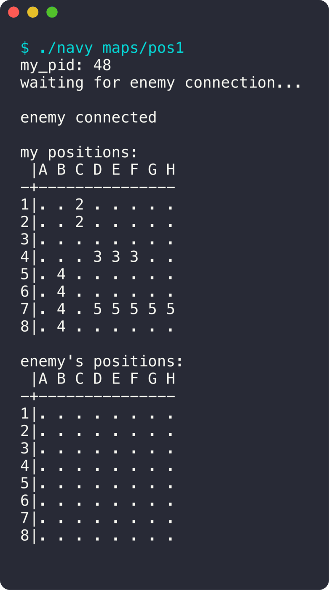

<div align="center">

# Navy

**Une bataille navale entre deux terminaux qui communiquent par signaux Unix.**

  

<sub>Projet à 2 · 2023</sub>

</div>

<br/>

<p align="center"></p>

## Le projet en quelques mots

Deux joueurs lancent le programme dans deux terminaux. Ils n'ont pas de socket : tout passe par **`SIGUSR1` et `SIGUSR2`**. Le second joueur se connecte au premier avec son PID, puis chacun voit sa flotte et la grille adverse.

## Ce que ça fait

- Connexion entre deux processus avec `kill` et `sigaction`
- Lecture et validation du fichier de positions des bateaux
- Affichage des deux grilles
- La phase d'attaque n'est pas terminée

## Lancer le projet

```bash
make
./navy maps/pos1
./navy <PID_joueur_1> maps/pos2
```

## L'équipe

<a href="https://github.com/Wilson-Epitech/navy/graphs/contributors"></a>

Yanis Harkouk, Wilson Bordichon

**Ma partition :** J'ai écrit la **connexion entre les deux terminaux** par signaux, la lecture et la vérification du fichier de positions, l'affichage des grilles et une partie de la bibliothèque utilitaire.
